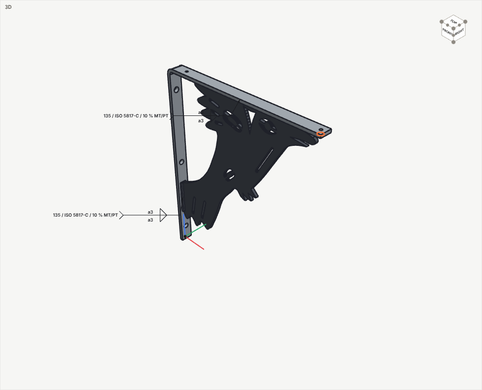
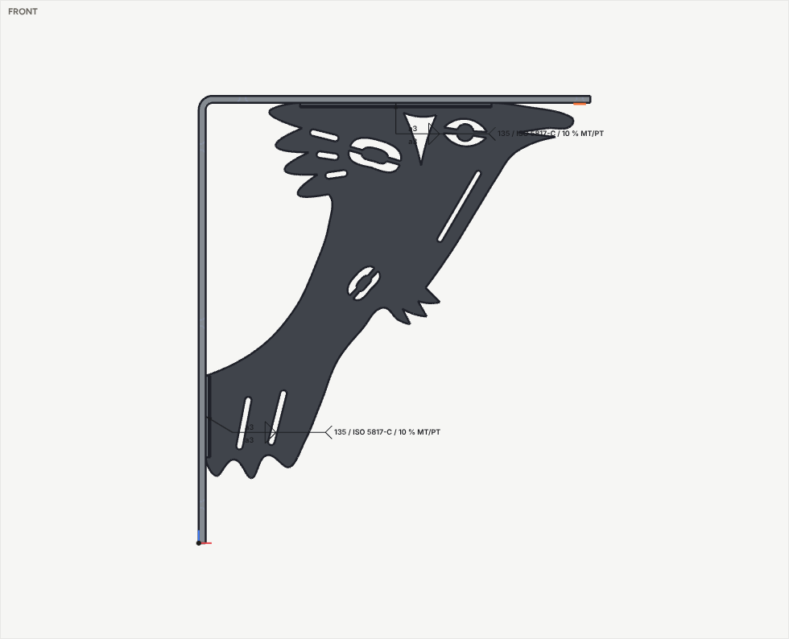

# Examples

## Pump housing: built entirely over MCP

A flanged pump housing with a screw-on cap. Claude built it in one session using only the SketchFlow MCP tools: no clicks, and no file written by hand. It exercises most of the modelling and checking tools.

| File | What it is |
|---|---|
| [`pump-housing.sf3d.json`](pump-housing.sf3d.json) | The finished model. Open it with File → *Open model file…*, load it with `model_session {action:"load", path:"examples/pump-housing.sf3d.json"}`, or use the bundled copy: File → *Example: Pump housing*, or `model_session {action:"example", id:"pump-housing"}` |
| [`pump-housing.step`](pump-housing.step) | The same assembly as a STEP file (AP214) for CAD. It has plain threads, as CAD systems exchange them, and it passed SketchFlow's vetting: closed solids, with volumes and areas matching the model. The four screws are one part placed four times |
| [`pump-housing.ops.json`](pump-housing.ops.json) | The recipe: the ten `model_build` batches as they were sent, each with its label. Replay them in order to rebuild the model from nothing (about 3.5 s) |

### What it uses

| Step | Op(s) | Capability shown |
|---|---|---|
| Base flange | `extrude` + `constrain` | A rounded rectangle with four **true arcs**. The constraints: tangency at every joint, equal radii, h / v, a fixed corner, and driving dimensions (R12, 116, 66). The solver reports **0 degrees of freedom** |
| Housing | `add cylinder {bore}`, mate to `flange:end`, `union` | A tube, as a cylinder with a bore |
| Gussets | `extrude {splines}` + `pattern circular ×4` | A **spline** profile (a smooth curve through fit points, blended into straight edges), stood upright with a pose and repeated round the flange face |
| Inlet pad | `add wedge` | An inclined face to work on |
| Port | `model_query {what:"faces", id:"pad"}` → `hole {kind:"tapped", modelled:true}` | Claude **asked for the slope's centre and normal** and put a modelled M5 thread square to it |
| Mounting | `hole {counterbore}` + `pattern grid 2×2`, `text {engrave}` | Counterbored M6 holes that stay on the flange corners. PUMP-01 is engraved on the flange top |
| Branding | `wrap {text:"SKETCHFLOW", mode:"engrave"}` | **Text wrapped round the curved housing.** It follows the housing's diameter if that changes |
| Neck | `add cylinder` + `thread {size:"custom", pitch:3, length:12}` | A modelled 60 × 3 thread on a tube |
| Cap | `add nut {shape:"knurled"}` + `joint screw {pitch:3}` + `text {path:"arc", emboss}` | A knurled cap with the matching internal thread, on a **screw joint**. "TURN TO OPEN" runs round an arc |
| Screws | `add bolt {M6 × 20, socket}` + `pattern` | Four stainless socket-head screws sitting in the counterbores |

### What Claude checked, and the answers

The figures are for the current release. Spline ends now meet a line as a true corner unless they set off within 45° of it, and that slightly changes the gussets: the first MCP session measured 600.6 g and 1097.8 mm² with the earlier rule.

| Call | Result |
|---|---|
| `model_describe` | flange sketch `{"dof": 0, "ok": true}`, no warnings |
| `model_query {what:"bbox"}` | 140 × 90 × 97 overall: the screw tips stand 16.4 mm below the flange, and the embossed text on the cap reaches z = 80.6. The housing alone is 76 mm tall |
| `model_query {what:"measure", from: flange.start, to: lid.top}` | 80 mm, faces antiparallel (180°) |
| `model_query {what:"section", axis:"z", offset:40}` | 1082.3 mm² of material through the housing wall and gussets |
| `model_check` | `{"overlaps": []}`. The cap's thread and the neck's mesh with 0.1 mm clearance; the screws clear their counterbores |
| `model_check {motion: cap 0→720°}` | `{"first_contact": null, "clear": true}`: two full turns of the cap without a touch |
| `model_mass` | flange (aluminium 6061) 528.56 g, cap (PETG) 41.07 g, 4 × M6 screws (304) 7.03 g each; **597.75 g** in total |
| `model_view` ×4 | isometric; cap screwed open (540°); a Y section; all four views |
| `model_export` | `.sf3d.json`, STL, drawing sheet SVG + DXF (exploded isometric with balloons), parts list CSV |

The same checks run in `npm test` (model suite). The example must rebuild with no warnings and a fully defined sketch, weigh 597.75 g, and show no interference. One turn of the cap must lift it exactly 3 mm, still clear of the neck.

## Crow shelf bracket: built over MCP, welded with the weld wizard

A heavy shelf bracket: one 1" × ¼" (25.4 × 6.35 mm) steel flat bar bent to 16" on the wall and 14" under the shelf, braced by a ¼" plate cut as a crow in a Northwest Coast formline-inspired style. The crow's breast is the strut: its tail is welded to the wall leg low down, and its wing and head are welded under the arm. Everything was made with MCP tool calls from an AI client: `model_build` batches for the parts, and `model_addon` calls to the welding add-on for the joints.

| File | What it is |
|---|---|
| [`crow-shelf-bracket.sf3d.json`](crow-shelf-bracket.sf3d.json) | The finished model. Open it with File → *Example: Crow shelf bracket*, File → *Open model file…*, or `model_session {action:"example", id:"crow-shelf-bracket"}` |
| [`crow-shelf-bracket.step`](crow-shelf-bracket.step) | The assembly as STEP (AP214), vetted on export: the bar has 5 holes (genus 5), the crow 13 cut-outs (genus 13) and no loose islands, and the four weld beads are their own bodies |
| [`crow-shelf-bracket.ops.json`](crow-shelf-bracket.ops.json) | The recipe: the six batches as they were sent, each with its label. The weld steps are `{op:"addon", addon:"welding", action:"apply"}`, so `model_build` replays them too |

### How it is made

| Step | Op(s) | What it shows |
|---|---|---|
| Bar | `extrude` with two `arcs` | The L as one profile with a bend: inside radius one thickness (6.35), outside two. It is extruded 1" (`end:"symmetric"`) and stood up with `rot:[90,0,0]` |
| Crow | `extrude` with 19 `splines` | The outline is a closed spline profile: rounded tail and wing feathers, three curved talons, the breast curve, a hooked beak. Its straight edges sit exactly on the bar's inner faces |
| Formline | 13 × `extrude {end:"through", into:"crow", mode:"subtract"}` | The eye is a lens cut as two crescents round a pupil. The wing-joint and hip ovoids are rings cut as two halves round an inner ovoid. There is a trigon between wing and head, a breast line, and feather and tail splits. Every cut is bridged, so nothing falls out of a laser-cut plate |
| Screws | 5 × `hole {M5, countersink, through}` | Three in the wall leg (the top one takes the tension; the open "window" behind the wing leaves driver room), two up into the shelf |
| Joints | `model_addon welding analyze / advise / apply` | The add-on finds two separate places where the crow meets the bar: 174 mm under the arm and 74 mm on the wall leg. Each is a tee, 6.35 on 6.35, open both sides. For regular service it gives double fillets a3 by 135 MAG (ISO 5817-C), welded overhead / vertical as modelled, so the welder turns the bracket over. `apply` places the fillets and the ISO 2553 symbols |

### What was checked

| Call | Result |
|---|---|
| `model_query {what:"bbox"}` | 355.6 × 25.4 × 406.4 mm: 14" × 1" × 16" |
| `model_check` | `{"overlaps": []}`: the fillets sit in the corners, inset 0.02 mm from the parts |
| `model_mass` | bar 941.9 g, crow 1992.5 g, weld metal 42.3 g: **2.98 kg** |
| `model_export` | `.sf3d.json`, STEP (vetted), STL, drawing SVG + DXF with both weld symbols and a weld schedule, parts list CSV |

The crow is formline-*inspired*, not a Haida design. Haida crests and formline designs belong to Haida artists and families. For a piece made to sell or show, commission or license the design from a Haida artist.

The same checks run in `npm test` (welding suite): the example must load with no warnings, measure 16" × 14" × 1", have two welded joints with symbols and no overlaps, and weigh about 2.98 kg.
