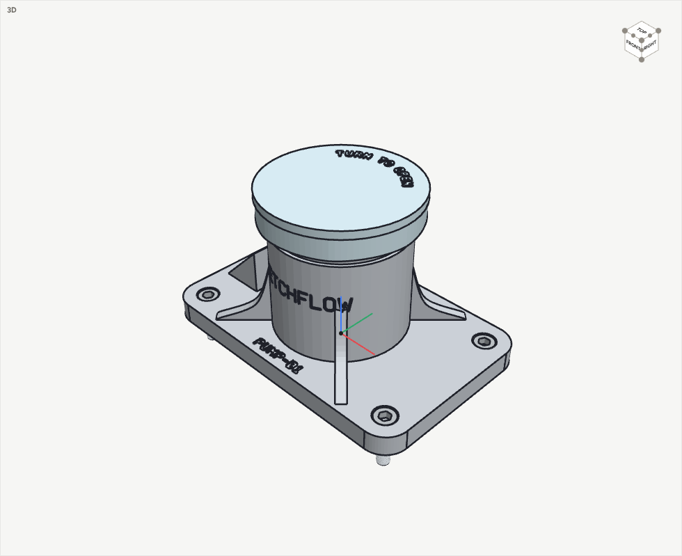
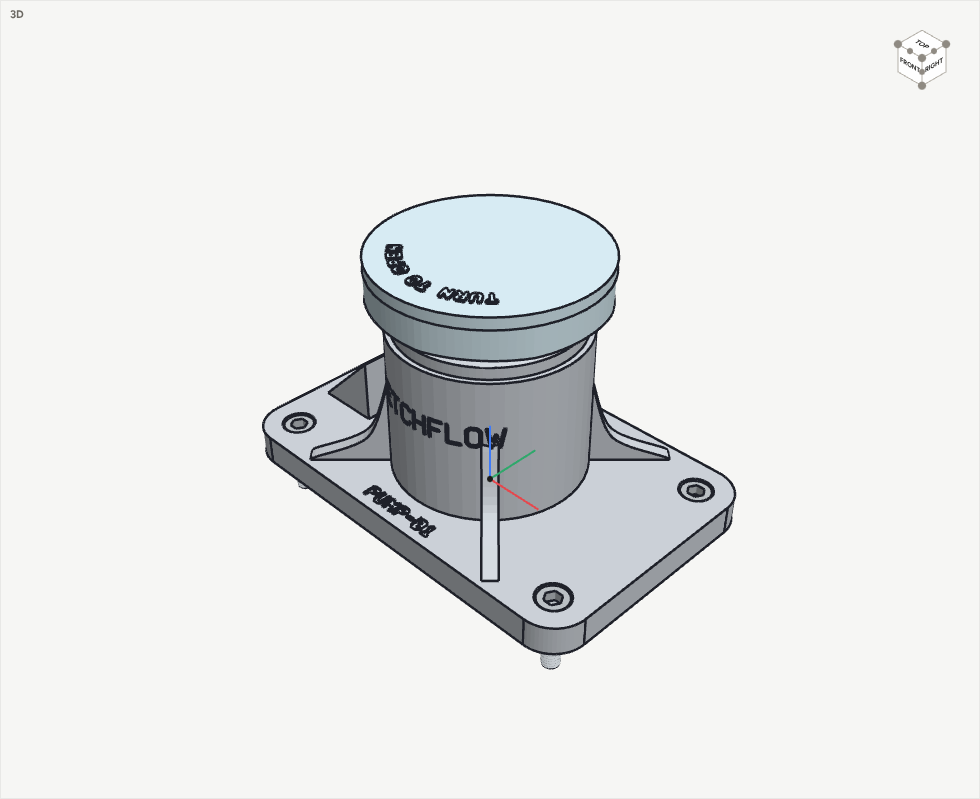
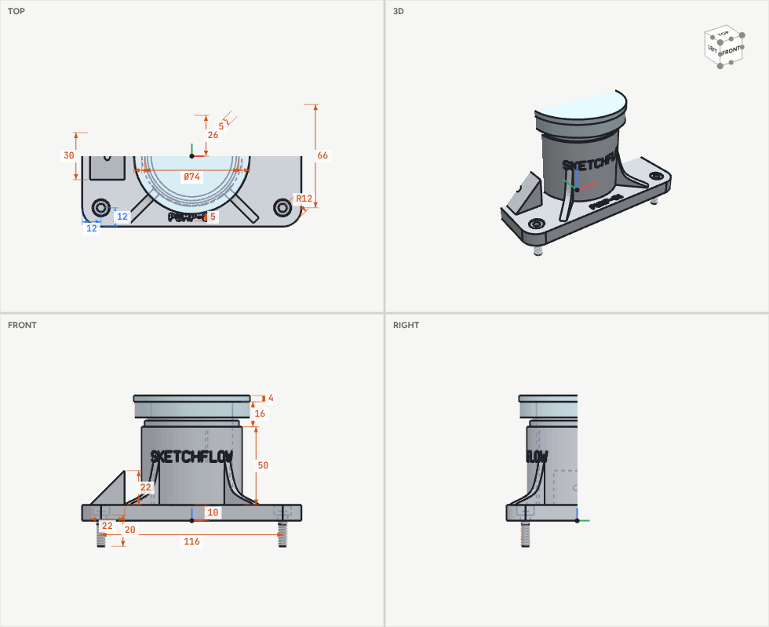

# Examples

## Pump housing: built entirely over MCP

A flanged pump housing with a screw-on cap. Claude built it in one session using only the SketchFlow MCP tools: no clicks, and no file written by hand. It exercises most of the modelling and checking tools.

| File | What it is |
|---|---|
| [`pump-housing.sf3d.json`](pump-housing.sf3d.json) | The finished model. Open it with File → *Open model file…*, load it with `model_session {action:"load", path:"examples/pump-housing.sf3d.json"}`, or use the bundled copy: File → *Example: Pump housing*, or `model_session {action:"example", id:"pump-housing"}` |
| [`pump-housing.step`](pump-housing.step) | The same assembly as a STEP file (AP214) for CAD. It has plain threads, as CAD systems exchange them, and it passed SketchFlow's vetting: closed solids, with volumes and areas matching the model. The four screws are one part placed four times |
| [`pump-housing.ops.json`](pump-housing.ops.json) | The recipe: the ten `model_build` batches as they were sent, each with its label. Replay them in order to rebuild the model from nothing (about 3.5 s) |

### What it uses

| Step | Op(s) | Capability shown |
|---|---|---|
| Base flange | `extrude` + `constrain` | A rounded rectangle with four **true arcs**. The constraints: tangency at every joint, equal radii, h / v, a fixed corner, and driving dimensions (R12, 116, 66). The solver reports **0 degrees of freedom** |
| Housing | `add cylinder {bore}`, mate to `flange:end`, `union` | A tube, as a cylinder with a bore |
| Gussets | `extrude {splines}` + `pattern circular ×4` | A **spline** profile (a smooth curve through fit points, blended into straight edges), stood upright with a pose and repeated round the flange face |
| Inlet pad | `add wedge` | An inclined face to work on |
| Port | `model_query {what:"faces", id:"pad"}` → `hole {kind:"tapped", modelled:true}` | Claude **asked for the slope's centre and normal** and put a modelled M5 thread square to it |
| Mounting | `hole {counterbore}` + `pattern grid 2×2`, `text {engrave}` | Counterbored M6 holes that stay on the flange corners. PUMP-01 is engraved on the flange top |
| Branding | `wrap {text:"SKETCHFLOW", mode:"engrave"}` | **Text wrapped round the curved housing.** It follows the housing's diameter if that changes |
| Neck | `add cylinder` + `thread {size:"custom", pitch:3, length:12}` | A modelled 60 × 3 thread on a tube |
| Cap | `add nut {shape:"knurled"}` + `joint screw {pitch:3}` + `text {path:"arc", emboss}` | A knurled cap with the matching internal thread, on a **screw joint**. "TURN TO OPEN" runs round an arc |
| Screws | `add bolt {M6 × 20, socket}` + `pattern` | Four stainless socket-head screws sitting in the counterbores |

### What Claude checked, and the answers

| Call | Result |
|---|---|
| `model_describe` | flange sketch `{"dof": 0, "ok": true}`, no warnings |
| `model_query {what:"bbox"}` | 140 × 90 × 97 overall: the screw tips stand 16.4 mm below the flange, and the embossed text on the cap reaches z = 80.6. The housing alone is 76 mm tall |
| `model_query {what:"measure", from: flange.start, to: lid.top}` | 80 mm, faces antiparallel (180°) |
| `model_query {what:"section", axis:"z", offset:40}` | 1097.8 mm² of material through the housing wall and gussets |
| `model_check` | `{"overlaps": []}`. The cap's thread and the neck's mesh with 0.1 mm clearance; the screws clear their counterbores |
| `model_check {motion: cap 0→720°}` | `{"first_contact": null, "clear": true}`: two full turns of the cap without a touch |
| `model_mass` | flange (aluminium 6061) 531.41 g, cap (PETG) 41.07 g, 4 × M6 screws (304) 7.03 g each; **600.6 g** in total |
| `model_view` ×4 | isometric; cap screwed open (540°); a Y section; all four views |
| `model_export` | `.sf3d.json`, STL, drawing sheet SVG + DXF (exploded isometric with balloons), parts list CSV |

The same checks run in `npm test` (model suite). The example must rebuild with no warnings and a fully defined sketch, weigh 600.6 g, and show no interference. One turn of the cap must lift it exactly 3 mm, still clear of the neck.
